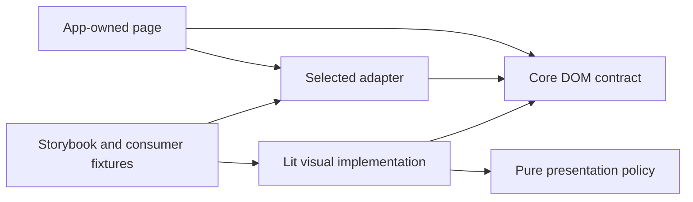

# Shared Home Assistant presentation foundation

- Status: Draft
- Date: 2026-11-04
- Catalog capability ID: shared-ui-foundation
- Last verified: Not applicable to implementation; documentation inventory checked on 2026-11-04.
- Owners: vypdev maintainers; Efrain Espada is the accountable product and publication owner.
- Scope: Shared presentation components, themes, catalog, framework adapters and actual consumer adoption.
- Related issues/PRs: [implementation issue #7](https://github.com/vypdev/ha-ui/issues/7), [documentation bootstrap #8](https://github.com/vypdev/ha-ui/issues/8), [Domus adoption #30](https://github.com/vypdev/domus/issues/30).
- Required review gates: Product UX, architecture, security, test inventory/coverage, packaging, original native SDD publication, consumer acceptance and publication rights.
- Open decisions blocking readiness: Exact dependency/support pins and public component signatures need engineering verification on issue #7. npm publication rights, Pages delivery and actual application compatibility remain unverified. These are pending gates, not delivered behavior.

## 1. Executive summary

Build one reusable presentation library for Gateway, Domus and future HA applications.
Lit implements the visual components; the public API uses DOM properties, attributes, slots,
typed events and CSS tokens. Deliver React, Vue, Angular and Svelte adapters in the same repository,
plus direct Lit and HTML/JavaScript consumption. A consumer installs only its chosen adapter.
The applications keep their own data, permissions, routes and page composition.

```text
Reviewed source -> packed core and adapters -> real compiled consumers -> shared Storybook
               -> Gateway adoption and Domus adoption -> verified versioned publication
```

Text equivalent: Review one component source, test its packed framework consumers, inspect the
same components in Storybook, then validate actual app adoption before declaring reuse complete.
This Draft is a catalog prerequisite. Merging its documentation does not publish a package,
establish native feature readiness or demonstrate any working adapter.

## 2. Problem, current behavior, and evidence

### 2.1 Problem

Gateway has reusable local presentation helpers. Copying those into each new app would duplicate
visual behavior and fixes. Domus needs household-specific sections and workflows with the same
maintained components and the common upper dashboard navigation, while future apps may use other frameworks.

### 2.2 Current behavior

1. At the admitted bootstrap base `8a0657d79a3c8d85414dbc1636ec94531e79a2bf`, ha-ui contains its README and installed Copilot resources, with no product source, package manifest, tests or Storybook.
2. The reviewed Gateway source at commit e47dde303e475a6d03e1d6697ec87a934e93263b has [Lit helper exports](https://github.com/vypdev/homeassistant-gateway/blob/e47dde303e475a6d03e1d6697ec87a934e93263b/frontend/src/ui/index.ts) and [primitives](https://github.com/vypdev/homeassistant-gateway/blob/e47dde303e475a6d03e1d6697ec87a934e93263b/frontend/src/ui/ui-primitives.ts). These paths are external research, not implementation evidence in ha-ui.
3. Its template callbacks and TemplateResult values are not a framework-neutral DOM contract. Extraction needs a deliberate public boundary and an adapter for existing Lit call sites.
4. Domus has separate task/household UI and unfinished recurrence/calendar work. Library documentation does not complete those workflows.

### 2.3 Evidence and unknowns

The owner authorized the separate repository, Storybook, required four framework adapters and
Domus-owned UX with the shared upper tab pattern. Issue #7 retains that scope. Gateway source is
MIT-licensed, copyright 2026 vypdev; implementation must pin the exact extraction commit and inspect
every copied code/asset notice. Upstream HA visual compatibility does not grant permission to copy
unreviewed assets. No npm owner permissions, package artifact, Pages site or adapter execution is yet proven.

### 2.4 Retrospective classification

Not applicable: this prospective Draft proposes a new library. Installed workflow files establish
repository setup, not an as-built component baseline.

## 3. Actors, surfaces, and terminology

| Actor | Goal | Entry point | Visible surface |
|---|---|---|---|
| Household member | Use familiar accessible controls | Domus or Gateway | App-owned pages using shared components |
| App developer | Compose a framework-native experience | Core or selected adapter | Typed imports, examples and migration guide |
| Component maintainer | Fix visual behavior once | ha-ui source and PR | Storybook, contracts and consumer fixtures |
| Publication owner | Release a reviewed compatible cohort | Native repository lifecycle | CI evidence, packed artifacts, package and Pages results |

Core means the one DOM component implementation. Adapter means a thin framework binding, never
another visual implementation. Cohort means compatible core/adapter releases tested together.
Navigation bar means links to application destinations; panel tabs mean local tab/tabpanel state.
They may look alike but must use the correct distinct accessibility semantics.

## 4. Goals, non-goals, and fixed invariants

### 4.1 Goals

| Requirement | Behavior |
|---|---|
| UIF-01 | Deliver one framework-neutral DOM component API with a Lit implementation and explicit registration; keep application data, authorization and routing in consumers. |
| UIF-02 | Deliver real React, Vue, Angular and Svelte adapter packages plus direct Lit/DOM consumption; verify idiomatic bindings, cleanup, forms and client/import boundaries. |
| UIF-03 | Extract reviewed Gateway presentation families once with theme tokens and preserved source/asset provenance; bundle all visual runtime assets locally. |
| UIF-04 | Provide the common HA-style upper navigation with explicit navigation-versus-panel semantics; let Domus choose its own sections and household experience. |
| UIF-05 | Publish one Storybook built from the same components, with EN/ES, light/dark, keyboard, narrow-screen and reduced-motion acceptance and reviewable PR artifacts. |
| UIF-06 | Start authored behavior with tests, enforce Clean Architecture and 100% statements, branches, functions and lines globally and per authored module; run CI Check on every PR commit. |
| UIF-07 | Ship versioned typed ESM packages with verified packed-artifact installation, framework compatibility, source integrity, publication rights and rollback guidance. |
| UIF-08 | Demonstrate actual Gateway and Domus adoption of the same reviewed package without duplicate visuals or weakened existing application/recovery behavior. |

### 4.2 Non-goals

No household task, calendar, inventory, points, rewards or automation policy belongs here.
No HA authentication, token handling, services, entities, MCP logic or app router belongs here.
This change does not publish a clone of HA private frontend bundles, a new framework, or a
second component implementation per adapter. Generic custom-element compatibility alone does
not establish a supported framework or SSR integration.

### 4.3 Fixed invariants

All required adapters and direct consumption remain first-cohort deliverables. Core behavior is
shared. Tests precede behavior and coverage may not be weakened by excluding authored modules.
Consumer permission/origin rules and original-operation recovery remain intact. Missing evidence
stays pending. No fake component screen, success state or package version represents delivery.

## 5. Current versus proposed product journey

| Stage | Current | Proposed | Observable effect |
|---|---|---|---|
| Choose framework | Gateway-local Lit helpers | Core or one real adapter | Framework choice does not fork visuals |
| Discover components | App-local catalog | One production-backed Storybook | Maintainer can inspect states before adoption |
| Build an app page | App components and styles | Shared controls, app-owned composition | Domus retains household-specific experience |
| Fix/upgrade | Independent duplicated changes | Reviewed cohort and consumer verification | One fix propagates through explicit app upgrades |
| Recover | App-specific rollback | Retained app artifact and compatible package cohort | A failed upgrade preserves user data and work |

## 6. Functional behavior and state model

### 6.1 Component contract

Use the proposed collision-resistant tag prefix `vyp-ha-`; do not register private HA `ha-*` names.
Define explicit client-side registration and per-component imports. Repeated registration of the
same compatible constructor is harmless; a conflicting installed cohort produces an actionable
error. Contract/type imports must be safe without browser globals. Components upgrade in the client;
server-rendered Shadow DOM and universal hydration are not promised.

Public inputs include typed properties for objects, bounded string/boolean attributes where
appropriate, named slots and documented CSS tokens. Text labels render as inert text. Do not accept
raw HTML strings or framework rendering callbacks in the common API. A Lit-only compatibility
entrypoint may translate existing helper calls, without leaking into core or other adapters.

Controlled state is owned by the app. Setting a property is not a user action and must not emit a
change event. User intent emits a documented typed event once, with reviewed bubbling/composed and
cancellation semantics. Inputs, options, event detail and link schemes are validated. Inputs assigned
before upgrade survive registration. Form controls support name/value, disabled, validation, reset,
submission and accessible labels through native semantics or one verified equivalent contract.

Shared families include tokens/type/spacing, upper navigation, buttons, text fields, selects,
checkboxes, cards, rows/grids, dialogs, status/empty/loading/error feedback and responsive layout.
Define each actual signature, event detail, slot and theme token before implementing its family.
No family is considered complete solely because a single example renders.

### 6.2 Framework adapters

Proposed packages are `@vypdev/ha-ui`, `@vypdev/ha-ui-react`, `@vypdev/ha-ui-vue`,
`@vypdev/ha-ui-angular` and `@vypdev/ha-ui-svelte`. Names remain subject to registry-rights verification.
Each adapter exposes typed idiomatic bindings/events/content projection and a tested form bridge;
Angular includes its appropriate value-accessor integration. React must survive its verified
rerender/remount lifecycle; Vue must preserve property/value updates; Svelte must preserve its
supported compiler binding contract. All delegate visuals, keyboard and accessibility to core.

Publish an exact tested compiler/runtime/browser matrix and peer ranges derived from it before
claiming support. Do not infer support for untested versions. Next.js, Nuxt and SvelteKit fixtures
must demonstrate a server shell with an explicit client registration/mount boundary, without
hydration warnings or server DOM access. Keep unsupported server component rendering explicit.

### 6.3 Lifecycle

| State | Meaning | Transition | Failure/recovery |
|---|---|---|---|
| Imported contracts | No browser effects | App reaches client boundary | Server import remains inert |
| Registered | Compatible tag defined | Mount component | Conflicts fail before silent reuse |
| Connected | Current inputs/listeners active | User action or input update | App owns accepted mutation/result |
| Disconnected | Owned subscriptions/overlays released | Reconnect | One current subscription set only |
| Upgrade rejected | Incompatible package/API | Restore reviewed cohort | Preserve app data, drafts and requests |

## 7. User-facing configuration

| Input | Type | Recommended default | Allowed values | Scope/persistence |
|---|---|---|---|---|
| Theme | Token set | Host-supplied reviewed HA-compatible tokens | Reviewed light/dark tokens and documented overrides | App root; no library storage |
| Locale | Language tag and messages | App locale, English fallback | EN/ES in initial acceptance; app labels remain data | App owns persistence |
| Navigation kind | Explicit enum | Navigation for app sections | Navigation links or local panel tabs | Component instance |
| Selected destination | Stable item ID | App-selected current location | One existing enabled item | App router or local controller |
| Motion | Host/media preference | Honor reduced motion | System preference or stronger reduced motion | Client session, no hidden persistence |
| Component state | Typed properties | Enabled and idle | Documented disabled/loading/error states | App-owned current inputs |

Invalid item identities, contradictory selected/disabled states, unsafe links and unknown enum values
must fail with a documented bounded diagnostic rather than selecting an arbitrary destination.
There is no global mutable singleton for locale, routing or household data. Recommended: app-level
theme/locale plus navigation links. Alternative: a standalone settings dialog with panel tabs and
its own explicit locale. A visual theme override cannot weaken focus, semantics or disabled behavior.

## 8. Clean Architecture design

| Boundary | Owns | Forbidden dependencies |
|---|---|---|
| Pure contracts/policy | Values, events, navigation/selection validation | DOM I/O, frameworks, app models |
| Component controllers | Presentation transitions and semantic ports | HA API, auth, database or application orchestration |
| Lit presentation | One DOM/visual implementation | React/Vue/Angular/Svelte packages, app business policy |
| Framework adapters | Framework mapping, cleanup and form bridge | Other frameworks or duplicate CSS/render behavior |
| Composition/examples | Explicit registration and fixture composition | Private HA modules and production credentials |
| Consuming apps | Router, permissions, commands, state and page composition | Dependence on another app running |



Text equivalent: Applications choose an adapter or core; adapters bind the common contract, one Lit
implementation renders it, and pure policy contains framework-independent decisions. Fixtures exercise
those public boundaries. No shared durable database, command ledger or business transaction is applicable.
Architecture checks enforce inward imports, acyclicity, framework isolation and absence of app/private-HA
imports. Test-only consumers may depend on their framework; they are not production core dependencies.

## 9. UI/UX and content contract

Domus chooses its own Overview, Tasks, Calendar, Shopping, Inventory, Family and Settings composition
as those workflows become real. Gateway retains its technical dashboard. Common upper navigation
matches the observed flat dashboard bar, active indicator, spacing, focus and narrow overflow behavior.
App destinations use links/current-location semantics; panel tabs use the tab/tabpanel pattern.
The shared component never invents routes, changes permissions or hides content as authorization.

Representative Storybook examples show meaning before details:

| State | Primary visible example | Action and retained state |
|---|---|---|
| Pending | Loading household tasks | No action; current app data remains |
| Action required | Name is required | Focus the named field; draft retained |
| Blocked | Tasks could not be loaded | Try again through the app's handler; existing tasks retained |
| Partial | Three changes saved; one needs review | Review the remaining change; saved facts remain visible |
| Complete | Changes saved | Continue to the selected section; no repeated mutation |

These are presentation fixtures, not business services inside ha-ui. Use concise accessible text,
headings and non-color status. Dynamic labels remain inert. The app supplies messages and authorization.
Storybook documents every family and significant state in both themes and EN/ES, narrow/wide layouts,
keyboard use and reduced motion. Test accessible names/roles, contrast, focus return and touch targets;
visual references supplement semantic assertions. A human review records whether the bar and controls
fit the host experience. No automated screenshot score substitutes for that judgment.
No unsolicited notifications, issue comments or remote telemetry are generated by components.

## 10. Failure, recovery, and cleanup

| Failure | Impact | Retained facts | Retry/action | Cleanup |
|---|---|---|---|---|
| Invalid input | A control cannot represent its requested state | Current valid app state | Correct the named input | No partial app mutation |
| Adapter teardown | A page closes | App data and commands | Remount with current inputs | Remove listeners/observers/overlays |
| Registration conflict | New cohort cannot mount safely | Existing definitions and app data | Load one compatible cohort | Never overwrite registered constructors |
| Consumer build fails | Upgrade is not accepted | Reviewed lock/artifact | Correct compatibility or roll back | Remove only owned generated output |
| Publication partial | Some remote artifacts may exist | Exact package digests and registry observations | Inspect each result before resuming | Never overwrite an existing version |
| App action fails | App decides business effect/result | App-owned drafts/receipt | App supplies recovery action | Library never retries a mutation |

Error order is impact, known cause, useful action and retained state. No hidden POST retry is applicable.
Retain review evidence, source/lock identity and one current rollback; remove disposable build/test output
after use without deleting authored inputs, another session's resources or unresolved diagnostics.

## 11. Security, permissions, and privacy

Core has no HA API access, tokens, storage, analytics, parent-frame DOM inspection or network fetches.
All runtime scripts/fonts/icons/styles are reviewed and bundled locally for both deployment modes.
Unknown assets and unsafe link schemes fail review. Text/event detail are data, never executable markup.
Each app retains permission and origin enforcement. Test malicious labels and injection-shaped inputs.
Storybook/fixtures use fictional household data and no private owner screenshots or credentials.
Publication uses the approved repository lifecycle with minimal package/Pages permissions; package
rights must be verified before publication. This Draft grants no new token or repository permissions.

## 12. Observability and operational UX

Consumers receive documented typed errors, not raw household payload dumps. CI and release evidence
identify source, lock, toolchain, package digest, tested framework/browser versions and results.
A missing package right or external delivery outage remains pending, distinct from a failed component
contract. No library background retries or remote log transport exist. Build/Pages diagnostics provide
one primary status/action and links; internal traces remain secondary and exclude secrets/private data.

## 13. Compatibility, migration, rollout, and rollback

1. Pin the reviewed Gateway source/license baseline; inventory every helper/style/asset to be extracted.
2. Prove packed fixtures for core and all adapters before broad extraction. Lock exact toolchains and
   derive public peer ranges from executed evidence; browser support includes current stable Chromium,
   Firefox and WebKit as pinned by the chosen browser harness, with actual results recorded.
3. Extract each family once and retain a tested Lit compatibility boundary while moving Gateway callers.
4. Adopt the same exact reviewed cohort in Domus through its admitted application work. Preserve
   Ingress/standalone, EN/ES, private drafts, identity/origin checks and original-operation recovery.
5. Retire local duplicate visuals only when the equivalent app journey passes. Record separate package,
   Storybook, Gateway and Domus readiness. A preview is not a Stable release.

Public exports/types/events/tokens follow semantic versioning. Start with an explicit compatible
cohort, coordinate breaking changes and publish migration notes. Do not silently auto-upgrade consumers.
Retain the prior tested app artifact/lock for rollback; this library has no household data migration.
A component update may not clear data or drafts to make adoption tests pass.

## 14. Testing strategy and numeric budget

The following 64 distinct cases are a minimum derived from contract, binding, packaging and adoption
risks. No test is yet implemented. Parameterization counts only independently asserted behavior.
A shared event exercised through several frameworks is separate only where actual framework behavior
is compiled and asserted. Later native appendices retain these cases without renaming or double counting.

| Area | Minimum distinct cases | Behaviors/risks covered |
|---|---:|---|
| Core DOM contracts | 16 | UIF-01, UIF-02, UIF-03, UIF-04, UIF-05, UIF-07 |
| Framework adapters | 16 | UIF-01, UIF-02, UIF-06 |
| Compiled consumer journeys | 10 | UIF-02, UIF-05, UIF-07 |
| Storybook and accessibility | 8 | UIF-03, UIF-04, UIF-05, UIF-06, UIF-07 |
| Packaging, CI and security | 8 | UIF-01, UIF-02, UIF-03, UIF-06, UIF-07 |
| Adoption and recovery | 6 | UIF-03, UIF-04, UIF-05, UIF-07, UIF-08 |
| **Total** | **64** | Each defined case counted once |

| Case ID | Area | Requirements | Scenario |
|---|---|---|---|
| shared-ui-foundation-C01 | Core DOM contracts | UIF-01,UIF-03 | Explicit repeated registration reuses compatible constructors and creates no duplicate styles or listeners. |
| shared-ui-foundation-C02 | Core DOM contracts | UIF-01,UIF-07 | A conflicting registered component cohort fails explicitly before an incompatible definition is silently reused. |
| shared-ui-foundation-C03 | Core DOM contracts | UIF-01,UIF-02 | Complex properties assigned before upgrade survive first connection and later replacement without string coercion. |
| shared-ui-foundation-C04 | Core DOM contracts | UIF-01,UIF-02 | Controlled value updates do not emit user-change events or overwrite the current value with stale internal state. |
| shared-ui-foundation-C05 | Core DOM contracts | UIF-01 | Invalid public configuration reports a bounded diagnostic without partial registration or invented application state. |
| shared-ui-foundation-C06 | Core DOM contracts | UIF-01,UIF-02 | Typed composed/bubbling events expose the documented inert detail once; cancellable requests honor cancellation. |
| shared-ui-foundation-C07 | Core DOM contracts | UIF-01,UIF-05 | Named/default slots and accessible names remain correct when localized content changes dynamically. |
| shared-ui-foundation-C08 | Core DOM contracts | UIF-03,UIF-05 | Buttons preserve native activation, disabled/loading prevention and visible keyboard focus without duplicate activation. |
| shared-ui-foundation-C09 | Core DOM contracts | UIF-03,UIF-05 | Text fields preserve labels, descriptions, validation, value, focus and form submission/reset semantics. |
| shared-ui-foundation-C10 | Core DOM contracts | UIF-03,UIF-05 | Select controls preserve typed values, keyboard selection, disabled options and form semantics. |
| shared-ui-foundation-C11 | Core DOM contracts | UIF-03,UIF-05 | Checkbox controls preserve checked/disabled state, accessible name and form reset semantics. |
| shared-ui-foundation-C12 | Core DOM contracts | UIF-04,UIF-05 | Upper navigation exposes links and current location, including modified-click behavior, without claiming panel tab semantics. |
| shared-ui-foundation-C13 | Core DOM contracts | UIF-04,UIF-05 | Panel tabs expose selected tab/panel relationships and keyboard movement with no duplicate or hidden focus targets. |
| shared-ui-foundation-C14 | Core DOM contracts | UIF-03,UIF-05 | Dialog open/cancel/confirm and disconnect return focus appropriately and clean overlays without trapping focus. |
| shared-ui-foundation-C15 | Core DOM contracts | UIF-01,UIF-03 | Untrusted labels and event detail remain inert text; unsafe link targets and raw HTML payloads are rejected. |
| shared-ui-foundation-C16 | Core DOM contracts | UIF-03,UIF-05 | Runtime light/dark and spacing tokens update connected components without changing global document styles. |
| shared-ui-foundation-C17 | Framework adapters | UIF-01,UIF-02,UIF-06 | React: compiled typed inputs and events preserve complex values and exactly-once event delivery. |
| shared-ui-foundation-C18 | Framework adapters | UIF-01,UIF-02,UIF-06 | React: idiomatic controlled forms preserve value, validation, disabled state and reset. |
| shared-ui-foundation-C19 | Framework adapters | UIF-01,UIF-02,UIF-06 | React: slots or framework content projection preserve accessible names and imperative focus. |
| shared-ui-foundation-C20 | Framework adapters | UIF-01,UIF-02,UIF-06 | React: mount, rerender, unmount and remount remove old listeners and preserve only current subscriptions. |
| shared-ui-foundation-C21 | Framework adapters | UIF-01,UIF-02,UIF-06 | Vue: compiled typed inputs and events preserve complex values and exactly-once event delivery. |
| shared-ui-foundation-C22 | Framework adapters | UIF-01,UIF-02,UIF-06 | Vue: idiomatic controlled forms preserve value, validation, disabled state and reset. |
| shared-ui-foundation-C23 | Framework adapters | UIF-01,UIF-02,UIF-06 | Vue: slots or framework content projection preserve accessible names and imperative focus. |
| shared-ui-foundation-C24 | Framework adapters | UIF-01,UIF-02,UIF-06 | Vue: mount, rerender, unmount and remount remove old listeners and preserve only current subscriptions. |
| shared-ui-foundation-C25 | Framework adapters | UIF-01,UIF-02,UIF-06 | Angular: compiled typed inputs and events preserve complex values and exactly-once event delivery. |
| shared-ui-foundation-C26 | Framework adapters | UIF-01,UIF-02,UIF-06 | Angular: idiomatic controlled forms preserve value, validation, disabled state and reset. |
| shared-ui-foundation-C27 | Framework adapters | UIF-01,UIF-02,UIF-06 | Angular: slots or framework content projection preserve accessible names and imperative focus. |
| shared-ui-foundation-C28 | Framework adapters | UIF-01,UIF-02,UIF-06 | Angular: mount, rerender, unmount and remount remove old listeners and preserve only current subscriptions. |
| shared-ui-foundation-C29 | Framework adapters | UIF-01,UIF-02,UIF-06 | Svelte: compiled typed inputs and events preserve complex values and exactly-once event delivery. |
| shared-ui-foundation-C30 | Framework adapters | UIF-01,UIF-02,UIF-06 | Svelte: idiomatic controlled forms preserve value, validation, disabled state and reset. |
| shared-ui-foundation-C31 | Framework adapters | UIF-01,UIF-02,UIF-06 | Svelte: slots or framework content projection preserve accessible names and imperative focus. |
| shared-ui-foundation-C32 | Framework adapters | UIF-01,UIF-02,UIF-06 | Svelte: mount, rerender, unmount and remount remove old listeners and preserve only current subscriptions. |
| shared-ui-foundation-C33 | Compiled consumer journeys | UIF-02,UIF-05,UIF-07 | Lit/DOM: a clean consumer installs packed artifacts, type-checks and runs tabs, fields, button and dialog interactions in a real browser. |
| shared-ui-foundation-C34 | Compiled consumer journeys | UIF-02,UIF-05,UIF-07 | Lit/DOM: the same browser consumer updates EN/ES content and theme at runtime, exercises narrow-screen keyboard navigation, then tears down without retained effects. |
| shared-ui-foundation-C35 | Compiled consumer journeys | UIF-02,UIF-05,UIF-07 | React: a clean consumer installs packed artifacts, type-checks and runs tabs, fields, button and dialog interactions in a real browser. |
| shared-ui-foundation-C36 | Compiled consumer journeys | UIF-02,UIF-05,UIF-07 | React: the same browser consumer updates EN/ES content and theme at runtime, exercises narrow-screen keyboard navigation, then tears down without retained effects. |
| shared-ui-foundation-C37 | Compiled consumer journeys | UIF-02,UIF-05,UIF-07 | Vue: a clean consumer installs packed artifacts, type-checks and runs tabs, fields, button and dialog interactions in a real browser. |
| shared-ui-foundation-C38 | Compiled consumer journeys | UIF-02,UIF-05,UIF-07 | Vue: the same browser consumer updates EN/ES content and theme at runtime, exercises narrow-screen keyboard navigation, then tears down without retained effects. |
| shared-ui-foundation-C39 | Compiled consumer journeys | UIF-02,UIF-05,UIF-07 | Angular: a clean consumer installs packed artifacts, type-checks and runs tabs, fields, button and dialog interactions in a real browser. |
| shared-ui-foundation-C40 | Compiled consumer journeys | UIF-02,UIF-05,UIF-07 | Angular: the same browser consumer updates EN/ES content and theme at runtime, exercises narrow-screen keyboard navigation, then tears down without retained effects. |
| shared-ui-foundation-C41 | Compiled consumer journeys | UIF-02,UIF-05,UIF-07 | Svelte: a clean consumer installs packed artifacts, type-checks and runs tabs, fields, button and dialog interactions in a real browser. |
| shared-ui-foundation-C42 | Compiled consumer journeys | UIF-02,UIF-05,UIF-07 | Svelte: the same browser consumer updates EN/ES content and theme at runtime, exercises narrow-screen keyboard navigation, then tears down without retained effects. |
| shared-ui-foundation-C43 | Storybook and accessibility | UIF-03,UIF-05 | Every component family is discoverable in the static Storybook and imports the production implementation. |
| shared-ui-foundation-C44 | Storybook and accessibility | UIF-05 | Normal, loading, disabled, empty and error examples communicate status and one useful action without color-only meaning. |
| shared-ui-foundation-C45 | Storybook and accessibility | UIF-05 | English and Spanish dynamic labels, descriptions and fallback are understandable at narrow and wide widths. |
| shared-ui-foundation-C46 | Storybook and accessibility | UIF-04,UIF-05 | Upper bar horizontal overflow preserves reachable destinations and visible active/focus state without clipped names. |
| shared-ui-foundation-C47 | Storybook and accessibility | UIF-03,UIF-05 | Light/dark reference states meet contrast and visible-focus checks against the recorded Gateway/HA visual references. |
| shared-ui-foundation-C48 | Storybook and accessibility | UIF-05 | Reduced-motion settings remove nonessential transitions without hiding state or breaking interaction. |
| shared-ui-foundation-C49 | Storybook and accessibility | UIF-05,UIF-06 | Keyboard and accessibility-tree assertions cover dialogs, forms and both navigation semantics beyond screenshot snapshots. |
| shared-ui-foundation-C50 | Storybook and accessibility | UIF-05,UIF-07 | Static Storybook works at the repository Pages subpath with local assets and retains a reviewable per-PR build. |
| shared-ui-foundation-C51 | Packaging, CI and security | UIF-03,UIF-07 | Packed core and adapter exports, declarations, source maps, licenses and asset notices match the reviewed source cohort. |
| shared-ui-foundation-C52 | Packaging, CI and security | UIF-02,UIF-07 | Each adapter declares only its framework peers plus core; a core-only consumer pulls no other framework or unnecessary component entrypoint. |
| shared-ui-foundation-C53 | Packaging, CI and security | UIF-01,UIF-02,UIF-07 | Documented server-safe contract imports work without window/document/customElements; browser registration stays behind the client boundary. |
| shared-ui-foundation-C54 | Packaging, CI and security | UIF-02,UIF-07 | Next.js fixture renders its server shell and mounts the client adapter without duplicate listeners, unsafe server DOM access or hydration warnings. |
| shared-ui-foundation-C55 | Packaging, CI and security | UIF-02,UIF-07 | Nuxt fixture renders its server shell and mounts the client adapter with the documented boundary and no hydration warnings. |
| shared-ui-foundation-C56 | Packaging, CI and security | UIF-02,UIF-07 | SvelteKit fixture renders its server shell and mounts the client adapter with the documented boundary and no hydration warnings. |
| shared-ui-foundation-C57 | Packaging, CI and security | UIF-06,UIF-07 | CI Check fails on any required test, per-module coverage, architecture, packed consumer or catalog failure and runs for each PR head. |
| shared-ui-foundation-C58 | Packaging, CI and security | UIF-01,UIF-03,UIF-07 | Browser assertions and static dependency checks reject hidden network loads, private HA modules, parent DOM/storage access and bundled credentials. |
| shared-ui-foundation-C59 | Adoption and recovery | UIF-03,UIF-04,UIF-08 | Gateway consumes the exact reviewed package for its common bar and presentation in both themes without altering MCP/business behavior. |
| shared-ui-foundation-C60 | Adoption and recovery | UIF-03,UIF-05,UIF-08 | Gateway package adoption preserves existing keyboard/narrow-screen workflows and recorded recovery behavior. |
| shared-ui-foundation-C61 | Adoption and recovery | UIF-04,UIF-08 | Domus Ingress uses the shared upper bar and existing household/task actions with verified identity and permission boundaries. |
| shared-ui-foundation-C62 | Adoption and recovery | UIF-04,UIF-08 | Domus standalone uses the same packed component cohort without HA parent-frame dependencies or changed origin policy. |
| shared-ui-foundation-C63 | Adoption and recovery | UIF-05,UIF-08 | Domus EN/ES private drafts, original-operation recovery and task/preference persistence survive shell adoption and reload. |
| shared-ui-foundation-C64 | Adoption and recovery | UIF-07,UIF-08 | A rejected package update can roll back to the retained reviewed cohort and previous app artifact without deleting household data or retained requests. |

Enforce 100% supported statements, branches, functions and lines globally and per authored module,
with an independent source inventory. Include production core/adapters and authored build/validation
logic; framework/generated/third-party code is identified separately rather than excluded to hide gaps.
Run meaningful negative architecture/coverage fixtures. Use deterministic clocks/IDs/fakes where
applicable, semantic assertions beyond golden images, and actual packed-package consumers.
Run the browser matrix in CI, including server-shell/client-boundary fixtures and both app deployments.
Local owner HA dogfooding is separate recorded acceptance using current authorization; it is not a unit
suite dependency. Required human visual/UX review remains open until recorded.

## 15. Documentation and discoverability

The documentation guide is the initial entrypoint. It will link usage for each framework, component
states, properties/events/slots/tokens, supported matrix, forms, SSR boundaries, migration, publishing,
source/license inventory and cleanup. Storybook and examples must use the actual shipped API.
The table is prospective at the bootstrap commit: implementation files do not exist or enter catalog
evidence until they are real. An implementation must declare additional actual paths before using them.

| Path | Change |
|---|---|
| specs/shared-ui-foundation.md | update |
| specs/catalog.json | update |
| specs/CATALOG.md | update |
| specs/README.md | reference |
| specs/_template.md | reference |
| README.md | update |
| docs/component-library.md | update |
| package.json | create |
| pnpm-workspace.yaml | create |
| pnpm-lock.yaml | create |
| tsconfig.json | create |
| LICENSE | create |
| .github/workflows/ci_check.yml | create |
| .github/workflows/storybook_pages.yml | create |
| packages/core/package.json | create |
| packages/core/src/index.ts | create |
| packages/core/src/contracts.ts | create |
| packages/core/src/register.ts | create |
| packages/react/package.json | create |
| packages/react/src/index.ts | create |
| packages/vue/package.json | create |
| packages/vue/src/index.ts | create |
| packages/angular/package.json | create |
| packages/angular/src/index.ts | create |
| packages/svelte/package.json | create |
| packages/svelte/src/index.ts | create |
| tests/contracts/core.test.ts | create |
| tests/contracts/adapters.test.ts | create |
| tests/architecture.test.mjs | create |
| tests/coverage-evidence.test.mjs | create |
| tests/consumers/packed.test.ts | create |
| tests/browser/components.spec.ts | create |
| examples/consumers/README.md | create |
| .storybook/main.ts | create |
| .storybook/preview.ts | create |
| stories/foundation.stories.ts | create |
| docs/compatibility.md | create |
| docs/migration.md | create |
| docs/provenance.md | create |
| docs/evidence/shared-ui-foundation.json | create |

The table describes the feature after this documentation bootstrap is merged; its existing rows are
updates/references at that future feature base. This documentation PR creates the standard, template,
primary draft, catalog/index and guide. It changes no Copilot-owned resource. Consumer repository
paths are owned and admitted separately; they are not falsely declared as ha-ui implementation files.

## 16. Acceptance scenarios

1. Given a clean supported framework project, installing only its packed adapter and core renders and
   operates the same tabs, fields, buttons and dialogs with correct typed values and no extra frameworks.
2. Given a server-rendered app shell, importing safe contracts has no browser effects; the documented
   client boundary mounts once with no hydration warning. Unsupported server rendering stays explicit.
3. Given an EN/ES narrow-screen keyboard user, destinations, labels, disabled/error states and focus
   remain understandable in both themes and reduced motion.
4. Given app rerender/disconnect/remount or repeated registration, no listener, observer, overlay or
   user-action delivery is duplicated; a conflicting cohort fails explicitly.
5. Given an unsafe label/link or malformed event payload, no code runs, private data is read or app
   mutation is retried by the library.
6. Given a common component fix, Storybook and all framework consumers use that same implementation;
   Gateway and Domus separately prove their preserved journeys with the reviewed package cohort.
7. Given a failing CI requirement or incomplete adapter/adoption result, CI Check and documentation
   report incomplete acceptance instead of claiming release readiness.
8. Given a rejected app upgrade or partial publication, retain exact prior artifacts/data and inspect
   observed remote state before retry; no existing package version is overwritten.

## 17. Requirements traceability

Each requirement links reciprocally to the distinct inventory above. Sections 6–13 own the contracts;
section 15 names prospective code, examples and documentation. Actual case-to-test/evidence mapping
is an implementation deliverable and currently absent.

| Requirement | Cases |
|---|---|
| UIF-01 | shared-ui-foundation-C01, shared-ui-foundation-C02, shared-ui-foundation-C03, shared-ui-foundation-C04, shared-ui-foundation-C05, shared-ui-foundation-C06, shared-ui-foundation-C07, shared-ui-foundation-C15, shared-ui-foundation-C17, shared-ui-foundation-C18, shared-ui-foundation-C19, shared-ui-foundation-C20, shared-ui-foundation-C21, shared-ui-foundation-C22, shared-ui-foundation-C23, shared-ui-foundation-C24, shared-ui-foundation-C25, shared-ui-foundation-C26, shared-ui-foundation-C27, shared-ui-foundation-C28, shared-ui-foundation-C29, shared-ui-foundation-C30, shared-ui-foundation-C31, shared-ui-foundation-C32, shared-ui-foundation-C53, shared-ui-foundation-C58 |
| UIF-02 | shared-ui-foundation-C03, shared-ui-foundation-C04, shared-ui-foundation-C06, shared-ui-foundation-C17, shared-ui-foundation-C18, shared-ui-foundation-C19, shared-ui-foundation-C20, shared-ui-foundation-C21, shared-ui-foundation-C22, shared-ui-foundation-C23, shared-ui-foundation-C24, shared-ui-foundation-C25, shared-ui-foundation-C26, shared-ui-foundation-C27, shared-ui-foundation-C28, shared-ui-foundation-C29, shared-ui-foundation-C30, shared-ui-foundation-C31, shared-ui-foundation-C32, shared-ui-foundation-C33, shared-ui-foundation-C34, shared-ui-foundation-C35, shared-ui-foundation-C36, shared-ui-foundation-C37, shared-ui-foundation-C38, shared-ui-foundation-C39, shared-ui-foundation-C40, shared-ui-foundation-C41, shared-ui-foundation-C42, shared-ui-foundation-C52, shared-ui-foundation-C53, shared-ui-foundation-C54, shared-ui-foundation-C55, shared-ui-foundation-C56 |
| UIF-03 | shared-ui-foundation-C01, shared-ui-foundation-C08, shared-ui-foundation-C09, shared-ui-foundation-C10, shared-ui-foundation-C11, shared-ui-foundation-C14, shared-ui-foundation-C15, shared-ui-foundation-C16, shared-ui-foundation-C43, shared-ui-foundation-C47, shared-ui-foundation-C51, shared-ui-foundation-C58, shared-ui-foundation-C59, shared-ui-foundation-C60 |
| UIF-04 | shared-ui-foundation-C12, shared-ui-foundation-C13, shared-ui-foundation-C46, shared-ui-foundation-C59, shared-ui-foundation-C61, shared-ui-foundation-C62 |
| UIF-05 | shared-ui-foundation-C07, shared-ui-foundation-C08, shared-ui-foundation-C09, shared-ui-foundation-C10, shared-ui-foundation-C11, shared-ui-foundation-C12, shared-ui-foundation-C13, shared-ui-foundation-C14, shared-ui-foundation-C16, shared-ui-foundation-C33, shared-ui-foundation-C34, shared-ui-foundation-C35, shared-ui-foundation-C36, shared-ui-foundation-C37, shared-ui-foundation-C38, shared-ui-foundation-C39, shared-ui-foundation-C40, shared-ui-foundation-C41, shared-ui-foundation-C42, shared-ui-foundation-C43, shared-ui-foundation-C44, shared-ui-foundation-C45, shared-ui-foundation-C46, shared-ui-foundation-C47, shared-ui-foundation-C48, shared-ui-foundation-C49, shared-ui-foundation-C50, shared-ui-foundation-C60, shared-ui-foundation-C63 |
| UIF-06 | shared-ui-foundation-C17, shared-ui-foundation-C18, shared-ui-foundation-C19, shared-ui-foundation-C20, shared-ui-foundation-C21, shared-ui-foundation-C22, shared-ui-foundation-C23, shared-ui-foundation-C24, shared-ui-foundation-C25, shared-ui-foundation-C26, shared-ui-foundation-C27, shared-ui-foundation-C28, shared-ui-foundation-C29, shared-ui-foundation-C30, shared-ui-foundation-C31, shared-ui-foundation-C32, shared-ui-foundation-C49, shared-ui-foundation-C57 |
| UIF-07 | shared-ui-foundation-C02, shared-ui-foundation-C33, shared-ui-foundation-C34, shared-ui-foundation-C35, shared-ui-foundation-C36, shared-ui-foundation-C37, shared-ui-foundation-C38, shared-ui-foundation-C39, shared-ui-foundation-C40, shared-ui-foundation-C41, shared-ui-foundation-C42, shared-ui-foundation-C50, shared-ui-foundation-C51, shared-ui-foundation-C52, shared-ui-foundation-C53, shared-ui-foundation-C54, shared-ui-foundation-C55, shared-ui-foundation-C56, shared-ui-foundation-C57, shared-ui-foundation-C58, shared-ui-foundation-C64 |
| UIF-08 | shared-ui-foundation-C59, shared-ui-foundation-C60, shared-ui-foundation-C61, shared-ui-foundation-C62, shared-ui-foundation-C63, shared-ui-foundation-C64 |

## 18. Implementation sequence

1. Merge this truthful documentation prerequisite; retry the existing issue #7 against the new trusted
   source. Native clarification, SDD publication and exact branch admission still precede feature code.
2. Resolve toolchain/support pins, signatures, registration and package rights; establish CI Check,
   independent coverage/architecture checks and test-first core/adapter scaffolding.
3. Prove real packed consumption in all required frameworks and server-shell/client boundaries.
4. Inventory provenance, then extract visual families once with contracts, accessibility and stories.
5. Complete the Storybook delivery and consumer documentation from the same shipped implementation.
6. Adopt actual reviewed artifacts through Gateway and Domus work, preserve recovery and verify both
   deployment modes; publish only when each required gate has supporting evidence.

## 19. Definition of Done

- [ ] Native feature SDD publication and exact Action-managed branch readiness verified.
- [ ] All eight requirements and 64 cases map to real tests/evidence without duplicates.
- [ ] One component implementation; four working adapters plus direct Lit/DOM consumption.
- [ ] Clean Architecture, complete per-module/global coverage and every-commit CI Check pass.
- [ ] Typed properties/events, forms, slots, lifecycle, client/SSR boundaries and compatibility matrix pass.
- [ ] Production-backed Storybook, EN/ES, themes, narrow/wide keyboard and reduced motion reviewed.
- [ ] MIT/source/asset provenance and package rights verified; packed/source integrity and Pages delivery accepted.
- [ ] Real Gateway and Domus adoption preserves business behavior, permissions, drafts and recovery.
- [ ] User/contributor/operator documentation, migrations and retained rollback are complete.
- [ ] Catalog evidence and original SDK-generated index match real implemented files and current status.
- [ ] No required adapter, app acceptance, human review or publication gate remains unverified.

## 20. References and decisions

- [ha-ui feature #7](https://github.com/vypdev/ha-ui/issues/7): full first-cohort scope.
- [Domus adoption #30](https://github.com/vypdev/domus/issues/30): app-owned shell and workflows.
- [Gateway source](https://github.com/vypdev/homeassistant-gateway): read-only extraction reference; exact code/license pin must accompany copied material.
- [Lit React integration](https://lit.dev/docs/frameworks/react/), [Vue Web Components](https://vuejs.org/guide/extras/web-components.html), [Angular custom elements schema](https://angular.dev/api/core/CUSTOM_ELEMENTS_SCHEMA) and [Svelte custom elements](https://svelte.dev/docs/svelte/custom-elements): primary integration references, not execution evidence for this library.
- [Copilot pre-branch SDDs](https://github.com/vypdev/copilot/blob/3e7ceea08e6131360e026937d1c0cc1b120472e0/docs/issues/pre-branch-sdds.mdx): proposed bootstrap and native gate.

Decisions: one repo/visual implementation; required React/Vue/Angular/Svelte adapters; Lit/DOM direct
use; own Storybook; Domus owns UX except the common upper bar pattern. Rejected: duplicated visual
libraries per framework, copying app components into Domus, or claiming Web Components alone prove
framework support. Exact signatures and toolchain pins remain engineering gates for issue #7.
