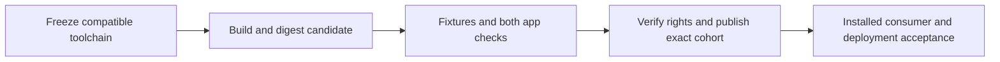
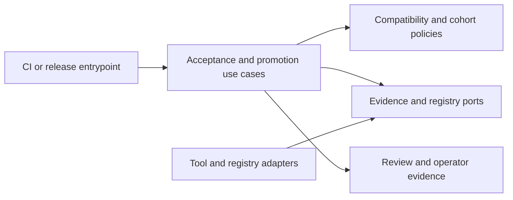

# Shared UI Framework Delivery

- Status: Draft
- Date: 2026-11-04
- Catalog capability ID: `shared-ui-foundation`
- Last verified: not applicable; this is a prospective companion
- Owners: vypdev maintainers; Efra Espada (accountable product and publication owner)
- Scope: Define executable delivery gates for the shared UI capability while retaining its existing owning contract.
- Related issues/PRs: [Issue #7](https://github.com/vypdev/ha-ui/issues/7); [Domus adoption issue #30](https://github.com/vypdev/domus/issues/30)
- Required review gates: product UX, architecture, testing, documentation, security/operations
- Open decisions blocking readiness: Exact locks, compiler/browser execution, justified public peer ranges, and verified npm publisher rights remain implementation gates. No unresolved product-scope decision is known.

This companion supplements [the retained foundation specification](shared-ui-foundation.md), which remains authoritative for product goals, UX, architecture, the complete baseline case inventory, and Gateway and Domus adoption gates. It does not replace, redefine, or recount that baseline. It is a proposed addition under the existing catalog owner; it is not implementation evidence or branch readiness.

## 1. Executive summary

Deliver the retained shared component capability through a reproducible, tested package cohort. First establish a pinned toolchain and real compiled consumer fixtures; then accept one immutable packed candidate, exercise it in fixtures and both applications, verify publication authority and artifact integrity, and publish and adopt that same cohort. The implementation stays within the existing owner's contract. The three requirements below refine delivery controls only.

```text
Pinned toolchain -> compiled fixtures and reviewed packed candidate -> Gateway and Domus checks -> verified publication -> installed consumer acceptance
```

No framework support, publication authority, or completed adoption is inferred from candidate versions or package names. Planned acceptance cases in this draft have not been executed.

## 2. Problem, current behavior, and evidence

### 2.1 Problem

The owner needs delivery evidence that makes the same shared implementation reproducible across framework adapters and real consumers. Unlocked tools, changed candidate bytes, temporary fixture paths, or partial publication could otherwise produce misleading support or adoption claims.

### 2.2 Current behavior

1. The validated catalog at base `d885bccf2c3152c3151471d3efaabd901429d6bd` records `shared-ui-foundation` as proposed, with no runtime implementation, entrypoints, code, or tests.
2. The repository currently contains documentation and the reviewed Copilot installation; no shared package, adapters, or Storybook are implemented or published.
3. Candidate registry versions are read-only research, not executed support claims. No consumer acceptance or publication-rights evidence is supplied.

### 2.3 Evidence

- Code/workflow/documentation references: `specs/shared-ui-foundation.md`; `specs/catalog.json`; `specs/CATALOG.md`; `specs/README.md`; `specs/_template.md`; `README.md`; `docs/component-library.md`.
- Related source: [Gateway presentation sources at the cited revision](https://github.com/vypdev/homeassistant-gateway/tree/e47dde303e475a6d03e1d6697ec87a934e93263b/frontend/src/ui).
- Owner scope decision: [Domus issue comment](https://github.com/vypdev/domus/issues/30#issuecomment-6620523378).
- External primary sources: candidate versions from read-only official registry metadata: Lit 3.3.3, React 19.3.1, Vue 3.5.44, Angular 22.2.4, Svelte 5.57.3, Vite 8.3.5, Storybook 10.6.5, Vitest 5.1.0, Playwright 1.64.1, TypeScript 6.0.3, and Node 24.20.0. These are candidates only. Angular compiler-cli 22.2.4 requires TypeScript >=6.0 <6.1; registry-latest TypeScript 7.0.2 is incompatible.
- Unknowns: Actual passing locks and browser matrix, public peer ranges, npm publisher rights, and implementation results.

### 2.4 Retrospective classification (as-built baselines only)

Not applicable: this is prospective delivery work and reconstructs no implemented baseline.

## 3. Actors, surfaces, and terminology

| Actor | Goal | Entry point | Visible surfaces |
|---|---|---|---|
| Component maintainer | Build and verify the same implementation and adapters | Repository changes and CI | Checks, packed artifacts, Storybook, docs |
| Gateway and Domus maintainers | Verify and adopt the accepted cohort | Their admitted owning work | Consumer builds, browser behavior, deployment evidence |
| Publication owner | Verify provenance, rights, and release cohort | Release review | Integrity records and registry results |
| Application user | Use the retained application experience | Gateway or Domus | Each application's own UI |

“Candidate” means a locally built packed artifact not yet accepted. “Accepted cohort” means the exact mutually reviewed package bytes and source revision. “Published cohort” means those exact bytes were observed at their authorized package coordinates. Neither term means application adoption. The primary product and technical language is English.

## 4. Goals, non-goals, and fixed invariants

### 4.1 Goals

| Requirement | Behavior |
|---|---|
| UIFD-01 | The compatibility gate MUST reject incompatible or unlocked candidate toolchains before accepting package artifacts, while retaining the previous reviewed lock and support evidence. |
| UIFD-02 | Promotion MUST verify the exact accepted candidate archive bytes and prevent temporary candidate dependency paths from entering shipped consumer manifests. |
| UIFD-03 | Partial cohort publication MUST preserve individually observed version and digest results and refuse overwrites or a false complete-cohort outcome during recovery. |

### 4.2 Non-goals

1. Redefine the retained foundation's product goals, component API, UX, architecture, or 64-case baseline.
2. Treat candidate package versions as proven compatibility, publisher rights, or implementation evidence.
3. Add another catalog owner, visual implementation, or private temporary dependency to a shipped application.

### 4.3 Fixed product/safety invariants

1. `specs/shared-ui-foundation.md` remains verbatim and authoritative; its UIF-01..UIF-08, 64 distinct baseline cases, required adapters, and both app-adoption gates remain required. This companion neither redeclares nor recounts those cases.
2. One common implementation owns visual behavior and accessibility. Gateway and Domus retain their own experiences; only the shared upper dashboard-style tab bar is the common navigation pattern.
3. Never claim support, publication, or adoption without the corresponding executed evidence. Preserve Copilot source and installed resources unchanged.

## 5. Current versus proposed product journey

| Stage | Current | Proposed | User/operator effect |
|---|---|---|---|
| Toolchain | No implementation evidence | Frozen, compatible lock and support evidence gate artifacts | Reproducible candidate and explicit failure reason |
| Candidate | No accepted archive | Build and record source revision, archive digest, dependencies, licenses, and compatibility | Reviewers can identify exact bytes |
| Consumer check | No real fixtures or app acceptance | Test packed bytes in framework fixtures and both admitted application workstreams | Adoption refers to one candidate |
| Publication | No publication evidence | Verify rights; publish exact accepted cohort; record per-coordinate result | Partial release is visible and recoverable |



Text equivalent: freeze toolchain -> build candidate -> check fixtures and applications -> verify rights and publish -> accept installed consumer behavior.

## 6. Functional behavior and state model

### 6.1 Happy path

1. CI validates exact direct and transitive locks, runtime/compiler compatibility, and the declared supported matrix.
2. The build produces reproducible packed artifacts and records source revision, package versions, integrity digests, dependencies, licenses, and compatibility.
3. Packed artifacts are installed in actual compiled direct-DOM and framework fixtures and exercised in both applications through their admitted work.
4. Review accepts the candidate only after the retained foundation gates and companion refinements pass. Publication rights and artifact digests are verified before publishing those exact bytes.
5. Consumer pins and deployed acceptance refer to the published version/digest cohort. Publication alone does not mark the capability implemented.

### 6.2 Alternative paths

- Incompatible or unlocked tools reject the candidate before acceptance; retain prior lock and evidence.
- Changed candidate bytes fail promotion; retain the accepted archive for inspection.
- A partial release records observed versions/digests by package and remains incomplete. Resume only exact verified results; never overwrite or claim completion.
- A rights failure blocks publication while allowing local candidate checks to be reported separately.

### 6.3 State machine

| State | Entered when | User-visible meaning | Allowed next states | Recovery/owner |
|---|---|---|---|---|
| Draft | Companion proposed | Delivery contract is not ready | Candidate | Maintainers resolve gates |
| Candidate | Frozen build produced | Unaccepted bytes available for checks | Accepted, rejected | CI and maintainers |
| Accepted | All applicable evidence and digests reviewed | Exact candidate may proceed to authorized release | Publishing, rejected on discrepancy | Review owner |
| Publishing | Authorized cohort release begins | Some package results may be irreversible | Published cohort, partial | Publication owner resumes by digest |
| Partial | One or more results observed, cohort incomplete | Release incomplete; consumers must not promote | Publishing, blocked | Publication owner inspects exact results |
| Published cohort | All exact package bytes observed | Packages available; app acceptance remains separate | Consumer acceptance | Application owners |
| Consumer accepted | Required installed/deployment evidence passes | Required adoption evidence is complete | Complete | Capability owner |
| Rejected/blocked | A gate fails | No new acceptance claim | Candidate after correction, or blocked | Responsible gate owner |

Duplicate release attempts MUST treat an exact version and matching digest as already observed; a conflicting digest MUST fail closed. Out-of-order or stale evidence cannot advance state. No automatic live-registry retry is specified; the owner resumes after inspecting recorded results.

## 7. User-facing configuration

This companion adds no end-user configuration. Tool versions and package peer ranges are release engineering inputs, recorded in exact locks and the compatibility record; they are not user-selectable settings. Proposed candidate pins are the versions listed in 2.3, with Node 24.20.0 and TypeScript 6.0.3 candidates. The reviewed lock MUST satisfy engine and compiler constraints; no absent or inconsistent lock may resolve implicit latest versions. Only versions actually passing compiled fixtures and browser checks may become supported pins or justified public peer ranges. The lock is immutable for an accepted candidate. No runtime feature or safety invariant is configurable.

## 8. Clean Architecture design

### 8.1 Responsibilities and dependency direction

| Layer/boundary | Owns | Must not own/import |
|---|---|---|
| Domain/pure policy | Compatibility, cohort completeness, digest and promotion invariants | Framework, registry SDK, application business rules |
| Application | Candidate acceptance and staged release decisions | Concrete registry clients or consumer-specific UX |
| Semantic ports | Read lock/build evidence, inspect packed bytes, record publish observations | Provider DTOs or policy decisions |
| Adapters/data | Package-manager, test-runner, browser, and authorized registry integration | Product policy |
| Infrastructure/composition | Frozen tools, deterministic fixtures, CI wiring | Duplicated compatibility decisions |
| Entrypoints | CI and explicit release invocation | Hidden retries or duplicated orchestration |
| Presentation | CI summaries, compatibility and release evidence | Mutations or acceptance policy |



### 8.2 Contracts, state, and trust boundaries

- Pure decisions: supported lock compatibility, candidate equality, promotion eligibility, and cohort completion.
- Application contracts: immutable source revision, lock digest, artifact identity/digest, and per-coordinate publication observation.
- Semantic ports: compatibility evidence, packed archive inspection, and publication observation.
- Durable state/schema ownership: repository lock and review evidence before release; append-only observed release record for publication results.
- Concurrency/idempotency: serialize publication per cohort; matching observed version/digest is idempotent; mismatch fails without overwrite.
- Trusted and untrusted inputs: package metadata, archives, consumer manifests, registry responses, and generated diagnostics are untrusted until structurally validated.
- Provider error mapping: distinguish incompatibility, integrity mismatch, authorization failure, transient provider error, and partial publication; never erase successful observations.

### 8.3 Executable architecture constraints

`tests/architecture.test.mjs` MUST enforce package dependency direction, reject application/service/business-rule imports from the component packages, and reject adapter dependencies on another framework adapter. `tests/delivery.test.mjs` MUST parse candidate and cohort records structurally and enforce digest, lock, and no-private-path rules. The common package alone owns visual behavior; adapters may bind framework lifecycle and forms behavior only.

## 9. UI/UX and content contract

### 9.1 Information hierarchy

CI, release review, and docs show current state, verified completed facts, next transition, required human action, impact and inspectable links, then technical diagnostics. A package publication result is never presented as application adoption.

### 9.2 Representative primary view

```markdown
# Shared UI delivery: partial publication

> **Current status:** 3 of 5 packages have matching published digests.
>
> **Action required:** Inspect the two remaining package results before resuming.

## Progress

- [x] Accepted candidate source revision and archive digests recorded
- [x] Three package results match the accepted cohort
- [ ] Two package results remain unverified
- [ ] Gateway and Domus installed acceptance remains pending

## What happens next

The publication owner checks the recorded versions and resumes only matching
accepted bytes. Consumer pins do not change while the cohort is partial.

## Links

[Issue #7](https://github.com/vypdev/ha-ui/issues/7) · [Release run](<run link>) · [Compatibility record](docs/compatibility.md)

<details><summary>Technical details</summary>Source revision, package coordinates, versions, digests, and sanitized provider diagnostics.</details>
```

### 9.3 Issue, PR, and comment behavior

- Titles identify the capability and state; PR summaries link the issue, exact source revision, CI run, compatibility record, packed artifact evidence, and consumer work.
- Merge/close does not imply publication or adoption. Retry means inspect the durable result and resume exact missing cohort members.
- CI checks are supplemental to recorded facts. Update the existing issue/PR evidence idempotently; no release automation comment is required. If comments are used, budget one status comment per transition and update it rather than posting retries.
- Use descriptive links, no fabricated local paths or runtime claims.

### 9.4 Accessibility, localization, and responsive behavior

The shared component surfaces retain the foundation's English and Spanish, keyboard, reduced-motion, light/dark, and narrow/wide requirements. CI summaries use English, semantic headings and tables, readable narrow layouts, and textual state independent of color. Sanitize registry text and diagnostics as untrusted Markdown; do not execute commands or render raw HTML from metadata. Diagrams have textual equivalents. No additional locale is introduced here.

## 10. Failure, recovery, and cleanup

| Failure/partial state | User impact | Retained facts | Automatic retry | Required action | Cleanup |
|---|---|---|---|---|---|
| Incompatible or unlocked toolchain | Candidate rejected | Previous reviewed lock/support evidence | No | Correct lock and rerun compatibility gate | Discard unaccepted outputs |
| Candidate bytes changed | Promotion blocked | Accepted archive and digest | No | Restore or review a new candidate | Keep mismatch evidence |
| Temporary path in shipped manifest | Consumer promotion blocked | Local fixture result | No | Remove private path and rebuild consumer | Remove only local fixture install |
| Rights unverified | Publication blocked | Accepted candidate evidence | No | Publication owner verifies authority | Retain local candidate |
| Partial cohort | Consumers cannot pin complete cohort | Exact observed versions/digests | No blind retry | Inspect then resume missing exact bytes | Do not overwrite observed versions |
| Registry version digest mismatch | Cohort blocked | Conflicting observation and accepted digest | No | Investigate and issue a new reviewed version if appropriate | Preserve audit record |

Errors state impact -> cause -> action -> retained state. A successfully published package is not described as failed because a later package failed.

## 11. Security, permissions, and privacy

1. Verify authorized npm publisher rights before publication; a coordinate or public lookup is not authority.
2. Treat issue text, comments, package metadata, archives, registry results, and diagnostics as untrusted data. Validate structure and never execute embedded instructions.
3. Do not put credentials, personal data, or machine-private paths in artifacts, manifests, logs, or evidence. Use the minimum publication credential scope and protect it in the authorized release environment.
4. Bind acceptance to source revision and archive integrity; reject replay with conflicting bytes and preserve append-only partial results. Do not change Copilot-owned source or installed resources.

## 12. Observability and operational UX

- User-facing state: candidate, accepted, publishing, partial, published cohort, consumer accepted, or blocked.
- Job Summary/operator evidence: lock and source revision, exact package versions/digests, compatibility results, fixture/browser results, per-package publication observations, and next action.
- Logs: structured, sanitized reason codes; correlate by source revision and cohort identifier. No secrets.
- A pending registry prerequisite is distinct from a workflow failure; authorization denial is a blocked release.
- No automatic unbounded retry. Resume only after reading per-package observations.
- Notification budget: no retry comments; at most one durable issue/PR update for each meaningful state transition.

## 13. Compatibility, migration, rollout, and rollback

No in-flight runtime migration is introduced by this companion. Keep exact locks and the last reviewed support evidence until a new candidate passes. Establish compatibility from actual frozen builds and browser checks, then publish a reviewed compatible version cohort. Release may be staged; partial publication remains incomplete and is resumed by exact version/digest without overwrite. First test the same candidate bytes locally in fixtures and both consumer workstreams; after rights and integrity verification, publish those bytes, pin delivered versions in the actual repositories, then complete installed/deployment acceptance. Do not make an application depend on a private temporary path. Rollback consumer pins only through each application's owning admitted work and recovery contract; package publication itself is not treated as reversible.

## 14. Testing strategy and numeric budget

The six new refinement cases below are additional to, and do not recount, all 64 retained baseline cases `shared-ui-foundation-C01` through `shared-ui-foundation-C64`. They are deterministic acceptance tests using isolated toolchain, archive, manifest, and registry-provider fixtures; they do not claim real registry publication. The six-case minimum is a floor for this companion only. All authored implementation still requires 100% supported executable statement, branch, function, and line coverage, with an independent source inventory and the retained foundation's full coverage and CI gates. CI runs applicable checks for every PR update, including type, architecture, build, browser, packaging, and coverage evidence. Use no live services or real waits; test exact failure and recovery facts. Human review must separately inspect application UX and deployment evidence.

| Area | Minimum distinct cases | Behaviors/risks covered |
|---|---:|---|
| Toolchain compatibility rejection | 2 | Observable scenarios in the case inventory. |
| Candidate promotion integrity | 2 | Observable scenarios in the case inventory. |
| Partial cohort recovery | 2 | Observable scenarios in the case inventory. |
| Total | 6 | Distinct inventory cases; repeated executions do not add cases. |

| Case ID | Area | Requirements | Scenario |
|---|---|---|---|
| shared-ui-framework-delivery-C01 | Toolchain compatibility rejection | UIFD-01 | With the supported Angular compiler candidate, substituting incompatible TypeScript 7 fails the compatibility/build gate before artifact acceptance; the reviewed TypeScript 6 lock remains unchanged. |
| shared-ui-framework-delivery-C02 | Toolchain compatibility rejection | UIFD-01 | An absent or inconsistent frozen transitive lock fails candidate creation without resolving an implicit latest dependency or changing retained lock/support evidence. |
| shared-ui-framework-delivery-C03 | Candidate promotion integrity | UIFD-02 | A candidate archive whose bytes change after acceptance fails digest/source-cohort verification before publication or consumer promotion, retaining the original accepted archive. |
| shared-ui-framework-delivery-C04 | Candidate promotion integrity | UIFD-02 | A staged app manifest with a machine-private temporary package dependency fails the shipped-consumer gate, while an isolated fixture can still exercise the accepted packed candidate locally. |
| shared-ui-framework-delivery-C05 | Partial cohort recovery | UIFD-03 | A simulated failure while publishing one adapter retains each already-observed exact version/digest and reports an incomplete cohort; it neither updates shipped consumer pins nor repeats verified successful publications. |
| shared-ui-framework-delivery-C06 | Partial cohort recovery | UIFD-03 | Recovery observes an existing version with different bytes than its accepted cohort record and fails without overwriting, silently substituting another version, or claiming that all adapters are delivered. |

## 15. Documentation and discoverability

| Audience | Artifact/page | Required content | Validation/navigation |
|---|---|---|---|
| User and application maintainer | `docs/component-library.md` | Normal adoption route, package use, and separation of publication from adoption | Links and packed consumer fixtures |
| Setup and release owner | `docs/compatibility.md`; `docs/provenance.md` | Exact matrix, rights, dependencies, licenses, revision, integrity, and staged release recovery | Compatibility and delivery checks |
| Operator | `docs/component-library.md` | State meanings and partial release recovery | Release evidence links |
| Contributor | `docs/migration.md`; `examples/consumers/README.md` | Migration, architecture, and compiled-consumer boundaries | Examples synchronized with fixtures |
| Storybook reviewer | `stories/foundation.stories.ts` | Shipped implementation examples and state/theme controls | Storybook build and review |

Prospective repository files (current documents are classified against the immutable base `d885bccf2c3152c3151471d3efaabd901429d6bd`):

| Path | Change |
|---|---|
| `specs/shared-ui-framework-delivery.md` | create |
| `specs/shared-ui-foundation.md` | reference |
| `specs/catalog.json` | update |
| `specs/CATALOG.md` | update |
| `specs/README.md` | update |
| `specs/_template.md` | reference |
| `README.md` | update |
| `docs/component-library.md` | update |
| `package.json` | create |
| `pnpm-workspace.yaml` | create |
| `pnpm-lock.yaml` | create |
| `tsconfig.json` | create |
| `packages/core/LICENSE` | create |
| `.gitignore` | create |
| `.node-version` | create |
| `.npmrc` | create |
| `packages/core/tsconfig.json` | create |
| `tooling/coverage.mjs` | create |
| `tests/coverage.test.mjs` | create |
| `LICENSE` | create |
| `.github/workflows/ci_check.yml` | create |
| `.github/workflows/storybook_pages.yml` | create |
| `packages/core/package.json` | create |
| `packages/core/src/index.ts` | create |
| `packages/core/src/contracts.ts` | create |
| `packages/core/src/register.ts` | create |
| `packages/react/package.json` | create |
| `packages/react/src/index.ts` | create |
| `packages/vue/package.json` | create |
| `packages/vue/src/index.ts` | create |
| `packages/angular/package.json` | create |
| `packages/angular/src/index.ts` | create |
| `packages/svelte/package.json` | create |
| `packages/svelte/src/index.ts` | create |
| `tests/contracts/core.test.ts` | create |
| `tests/contracts/registration.test.ts` | create |
| `tests/browser/tabs.test.ts` | create |
| `tests/contracts/adapters.test.ts` | create |
| `tests/architecture.test.mjs` | create |
| `tests/coverage-evidence.test.mjs` | create |
| `tests/consumers/packed.test.ts` | create |
| `tests/browser/components.spec.ts` | create |
| `examples/consumers/README.md` | create |
| `.storybook/main.ts` | create |
| `.storybook/preview.ts` | create |
| `stories/foundation.stories.ts` | create |
| `docs/compatibility.md` | create |
| `docs/migration.md` | create |
| `docs/provenance.md` | create |
| `docs/evidence/shared-ui-foundation.json` | create |
| `packages/core/src/components/button.ts` | create |
| `packages/core/src/components/field.ts` | create |
| `packages/core/src/components/tabs.ts` | create |
| `packages/core/src/components/dialog.ts` | create |
| `packages/core/src/tokens.ts` | create |
| `packages/svelte/src/Button.svelte` | create |
| `packages/svelte/src/Field.svelte` | create |
| `packages/svelte/src/Tabs.svelte` | create |
| `packages/svelte/src/Dialog.svelte` | create |
| `playwright.config.ts` | create |
| `vitest.config.ts` | create |
| `examples/dom/package.json` | create |
| `examples/dom/README.md` | create |
| `examples/react/package.json` | create |
| `examples/react/README.md` | create |
| `examples/vue/package.json` | create |
| `examples/vue/README.md` | create |
| `examples/angular/package.json` | create |
| `examples/angular/README.md` | create |
| `examples/svelte/package.json` | create |
| `examples/svelte/README.md` | create |
| `examples/next/package.json` | create |
| `examples/next/README.md` | create |
| `examples/nuxt/package.json` | create |
| `examples/nuxt/README.md` | create |
| `examples/sveltekit/package.json` | create |
| `examples/sveltekit/README.md` | create |
| `tooling/packaging.mjs` | create |
| `tooling/compatibility.mjs` | create |
| `tests/delivery.test.mjs` | create |
| `docs/framework-adapters.md` | create |
| `packages/angular/LICENSE` | create |
| `packages/angular/ng-package.json` | create |
| `packages/angular/tsconfig.json` | create |
| `packages/react/LICENSE` | create |
| `packages/react/tsconfig.json` | create |
| `packages/svelte/LICENSE` | create |
| `packages/svelte/src/types.ts` | create |
| `packages/svelte/svelte.config.js` | create |
| `packages/svelte/tsconfig.json` | create |
| `packages/vue/LICENSE` | create |
| `packages/vue/tsconfig.json` | create |
| `tests/browser/angular.test.ts` | create |
| `tests/browser/fixtures/SvelteTabs.svelte` | create |
| `tests/browser/framework-fixture.ts` | create |
| `tests/browser/react.test.ts` | create |
| `tests/browser/svelte.test.mjs` | create |
| `tests/browser/vue.test.ts` | create |
| `tests/consumers/fixtures/angular/client.ts` | create |
| `tests/consumers/fixtures/angular/index.html` | create |
| `tests/consumers/fixtures/angular/model.ts` | create |
| `tests/consumers/fixtures/angular/package.json` | create |
| `tests/consumers/fixtures/angular/pnpm-lock.yaml` | create |
| `tests/consumers/fixtures/angular/pnpm-workspace.yaml` | create |
| `tests/consumers/fixtures/angular/tsconfig.json` | create |
| `tests/consumers/fixtures/react/client.ts` | create |
| `tests/consumers/fixtures/react/index.html` | create |
| `tests/consumers/fixtures/react/model.ts` | create |
| `tests/consumers/fixtures/react/package.json` | create |
| `tests/consumers/fixtures/react/pnpm-lock.yaml` | create |
| `tests/consumers/fixtures/react/pnpm-workspace.yaml` | create |
| `tests/consumers/fixtures/react/tsconfig.json` | create |
| `tests/consumers/fixtures/svelte/Consumer.svelte` | create |
| `tests/consumers/fixtures/svelte/client.ts` | create |
| `tests/consumers/fixtures/svelte/index.html` | create |
| `tests/consumers/fixtures/svelte/model.ts` | create |
| `tests/consumers/fixtures/svelte/package.json` | create |
| `tests/consumers/fixtures/svelte/pnpm-lock.yaml` | create |
| `tests/consumers/fixtures/svelte/pnpm-workspace.yaml` | create |
| `tests/consumers/fixtures/svelte/tsconfig.json` | create |
| `tests/consumers/fixtures/vue/client.ts` | create |
| `tests/consumers/fixtures/vue/index.html` | create |
| `tests/consumers/fixtures/vue/model.ts` | create |
| `tests/consumers/fixtures/vue/package.json` | create |
| `tests/consumers/fixtures/vue/pnpm-lock.yaml` | create |
| `tests/consumers/fixtures/vue/pnpm-workspace.yaml` | create |
| `tests/consumers/fixtures/vue/tsconfig.json` | create |
| `tests/consumers/frameworks.ts` | create |
| `tsconfig.consumers.json` | create |
| `tsconfig.svelte-tests.json` | create |
| `tsconfig.svelte-source.json` | create |

The catalog/index update registers the companion under the existing owner; it does not claim implementation. `LICENSE` preserves the upstream MIT source notice and every reused asset requires provenance verification. The Copilot installation and its source remain unchanged. Package coordinates are identifiers, not repository paths.

## 16. Acceptance scenarios

1. Given a frozen supported candidate lock, when compatibility and compiled consumer checks run, then only passing toolchain evidence can advance a candidate toward review; planned tests are not treated as completed results.
2. Given the Angular compiler candidate, when TypeScript 7 is substituted, then the candidate is rejected and the reviewed TypeScript 6 lock/support evidence remains intact.
3. Given an accepted archive, when its bytes differ during promotion, then publication and consumer promotion fail and the original accepted bytes remain inspectable.
4. Given an application manifest with a private temporary candidate dependency, when the shipped-consumer gate runs, then shipping is blocked while isolated fixture testing remains possible.
5. Given publication succeeds for only part of a cohort, when recovery begins, then exact per-package results remain recorded and no consumer pins or complete-cohort claim are advanced.
6. Given an existing package version has a conflicting digest, when recovery inspects it, then it neither overwrites nor substitutes the artifact and remains incomplete.
7. Given candidate evidence passes, when publication rights are not verified, then release is blocked with the accepted candidate retained and a clear owner action.
8. Given a package cohort is published, when application acceptance is reviewed, then publication alone does not satisfy Gateway or Domus adoption; each retained owning gate must pass.

## 17. Requirements traceability

| Requirement | Cases |
|---|---|
| UIFD-01 | shared-ui-framework-delivery-C01, shared-ui-framework-delivery-C02 |
| UIFD-02 | shared-ui-framework-delivery-C03, shared-ui-framework-delivery-C04 |
| UIFD-03 | shared-ui-framework-delivery-C05, shared-ui-framework-delivery-C06 |

The retained foundation's requirements and cases remain traced in `specs/shared-ui-foundation.md`; this table covers only the three companion refinements. Documentation and architecture deliverables are additionally verified by their named structural checks and the retained baseline's gates, not by inventing generic cases.

## 18. Implementation sequence

1. Register this companion under the existing catalog owner, retaining the primary specification verbatim.
2. Freeze compatible direct and transitive toolchain locks; implement and run the compatibility rejection gate.
3. Establish package contracts and dependency constraints, then compiled direct-DOM and four framework fixtures using actual packed artifacts.
4. Implement accepted-candidate digest and no-private-path promotion checks; retain the full foundation's tests-first, coverage, component, Storybook, and browser scope.
5. Exercise the immutable candidate in both admitted application workstreams and complete their separate UX, deployment, and Bugbot gates.
6. Verify publication rights and provenance, then publish the exact accepted compatible cohort. Record and recover partial outcomes by exact version/digest.
7. Pin the delivered cohort in actual consumers and complete installed/deployment acceptance; update catalog evidence only for verified implementation.
8. Complete human UX review, documentation, original SDK catalog validation, and all Definition of Done gates.

## 19. Definition of Done

- [ ] The retained `specs/shared-ui-foundation.md` remains verbatim and its UIF-01..UIF-08, all 64 cases, adapters, Storybook, and both app-adoption gates pass.
- [ ] UIFD-01 through UIFD-03 have their six distinct executable refinement cases and reciprocal traceability.
- [ ] Exact supported locks and compatibility matrix come from passing builds and browser evidence; no broad or legacy support is inferred.
- [ ] Candidate acceptance and consumer promotion verify exact archive bytes and reject private temporary dependencies.
- [ ] All authored implementation has 100% supported statement, branch, function, and line coverage; source inventory, type, architecture, build, browser, and packaging checks pass for each PR update.
- [ ] Provenance, licenses, source revision, dependency list, integrity, and publisher rights are verified before publication.
- [ ] Partial publication recovery preserves exact observations and never overwrites or falsely completes a cohort.
- [ ] Actual packed artifacts pass fixtures; Gateway and Domus separately pass their owning installed/deployment and human UX gates with no open, reopened, or unknown Bugbot findings.
- [ ] English documentation, migration, troubleshooting, compatibility, provenance, and examples are discoverable and validated.
- [ ] Catalog and generated view are current using the documented original SDK validation; catalog evidence does not claim absent implementation.
- [ ] Copilot source and installed resources remain unchanged; all required review gates and original publication checks pass.

## 20. References and decisions

- Primary owner contract: `specs/shared-ui-foundation.md`.
- Canonical issue: [vypdev/ha-ui issue #7](https://github.com/vypdev/ha-ui/issues/7).
- Consumer adoption: [vypdev/domus issue #30](https://github.com/vypdev/domus/issues/30); Gateway work remains with its owning admitted work.
- Gateway source evidence: [presentation directory at cited revision](https://github.com/vypdev/homeassistant-gateway/tree/e47dde303e475a6d03e1d6697ec87a934e93263b/frontend/src/ui).
- Decisions: one Lit implementation behind DOM contracts and framework adapters; no HA private runtime dependency; candidate testing precedes publication; both applications exercise the same immutable candidate before rights-verified release; publication and application adoption remain separate evidence.
- Follow-up outside this companion: none. All product and component acceptance remains governed by the retained foundation specification.
